# OpenVLA-OFT: Conditional Patch Utility for Action-Dependent Interaction

**Period:** 2026-09-18 20:28 KST (launch) → 2026-09-19 11:20 KST (20/20 episodes, 69 observations, analysis complete); single-episode dense run added 2026-09-19 19:38 KST
**Model:** `moojink/openvla-7b-oft-finetuned-libero-spatial` (OpenVLA-OFT, 2 camera views × 256 patches, 8-step action chunks, L1-regression head)
**Benchmark:** LIBERO-Spatial, 10 tasks × 2 episodes (default initial states 0 and 1)
**Hardware:** 1× RTX 5090 (robot18), conda env `openvla-oft`, code under `src/openvla-oft/`
**Predecessor:** `../2026-08-19_to_2026-08-21_openvla-oft_retention-sweep_and_oracle-patch-selection/` (oracle evaluator, keep-0 baseline, VLA-Pruner sweep)

---

## 1. Background — why this experiment

The August study showed that at 1–2 patches per view the greedy oracle stays at the unpruned ceiling while attention-based VLA-Pruner collapses, and that the oracle tends to keep one bowl patch plus one patch between the gripper fingers. That suggested the hypothesis tested here:

> A gripper patch has weak standalone action relevance, but becomes important once a target-object patch is already retained, because the action depends on the relative target–gripper configuration.

The motivation is the decomposition I(A; X_i | X_S, C) = I(A; X_i | C) + I(X_i; X_S | A, C) − I(X_i; X_S | C): standalone relevance, action-dependent interaction, and redundancy. **This experiment does not estimate mutual information.** It uses preservation of the full-input action chunk, measured by MSE in normalized action space, as an empirical proxy for a patch's incremental contribution.

## 2. Verification — experiment design

### 2.1 Pipeline (unchanged from August)
Layers 0–3 see all 512 visual tokens; pruning happens after layer 3 (`fastv_k = 3`); non-visual tokens are always kept; the same tail forward (layers 4–31, bidirectional attention, original RoPE positions) and action head produce the chunk; queries 1–3 of every episode run unpruned (warm-up) and are never analysed. Only the set of retained patches changes. New code is a guarded `_cpu_mode` branch in `modeling_prismatic.py` (`_conditional_patch_utility_tables`), plus `run_conditional_patch_utility.py` and `analyze_conditional_patch_utility.py` under `experiments/robot/libero/`.

### 2.2 Protocol
- **Rollout.** The unpruned policy drives the episode (A_full is executed), so observations stay on real grasp trajectories; all 20 episodes succeeded. Every 3rd query after warm-up is analysed (queries 4, 7, 10, … in the first episode of a task; 5, 8, 11, … in the second), giving 69 observations.
- **Per observation**, the evaluator is run on: no visual patch (the keep-0 condition already evaluated in August), each of the 512 single patches, and all 130,816 unordered patch pairs over both views (~13 min, 30 GB). Standalone scores, conditional maps for any X_o, the named pairs and the global two-patch oracle are all read from that table. Every tail forward uses the same batch shape, and two runs of the same observation were bit-identical.
- **Definitions.** X_o = the target-object patch with the lowest standalone MSE (reported for X_o in any view, agentview only, wrist only). U_standalone(i) = MSE(none) − MSE(i). U_conditional(i) = MSE(X_o) − MSE(X_o, i). G = U_conditional − U_standalone; the relative version divides each utility by its own starting error. X_g and X_o2 are the best gripper / other-target patch by conditional utility, so both pairs get their strongest partner.
- **Labels.** Patch categories come from a MuJoCo segmentation render of the same simulator state (verified not to perturb RGB or physics), pushed through the same rotate/resize/crop as the image. A patch takes the dominant non-background category covering ≥ 20 % of its pixels: target object (`obj_of_interest[0]`), gripper, robot arm, goal object (the plate), other object, background.
- **VLA-Pruner.** Its own picks are recorded on the same observations at 1 patch/view (2 patches) and 2 patches/view, each budget with its own temporal history, and scored through the same evaluator.

## 3. Results

### 3.1 Action error by retained patch set

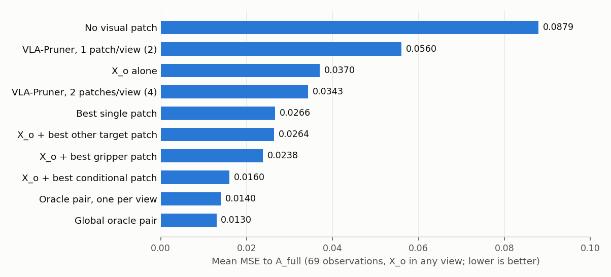

*Figure 1. Mean MSE to A_full over 69 observations (X_o in any view).*

At the same two-patch budget the brute-force oracle pair leaves 0.0130 against 0.0560 for VLA-Pruner's own two patches (median ratio 4.3×, range 1.6–22.7×). VLA-Pruner's two patches are **worse than keeping no visual patch in 17 % of observations**, and its four patches (2 per view, 0.0343) are worse than the two-patch oracle in 97 %. Restricting the oracle to one patch per view costs little (0.0140), yet the unrestricted oracle spans both views in only 57 % of observations (both patches from the wrist view in 29 %, both from the agentview in 14 %).

### 3.2 The hypothesis holds inside one image, and is overridden by the second camera

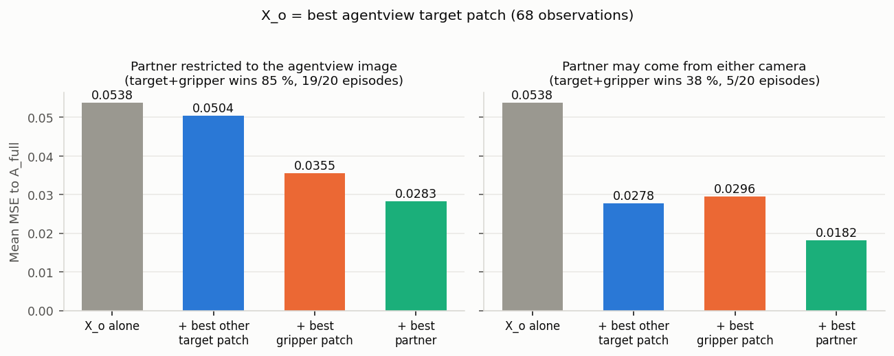

*Figure 2. X_o = best agentview target patch. Left: the partner must also come from the agentview image. Right: the partner may come from either camera.*

- **Within the agentview image** (the setting of the original target-then-gripper picture): adding a second target patch barely helps (0.0538 → 0.0504), adding the best gripper patch helps a lot (→ 0.0355). Target + gripper beats target + target in **85 % of observations and 19 of 20 episodes** (episode-clustered Wilcoxon p < 0.001).
- **With both cameras available**: the best second patch is in the *other* view in 75 % of observations, and a wrist-view target patch (0.0278) is a better partner than any gripper patch (0.0296). Target + gripper then wins in only 38 % (5/20 episodes; episode-clustered p ≈ 0.03 in the opposite direction).
- With X_o chosen in any view (it lands in the wrist view in 44 of 69 observations), target + gripper wins in 59 % (14/20 episodes, mean difference −0.0026, episode-clustered p = 0.006).

### 3.3 Why target + gripper wins inside one image: redundancy, not a gripper that "switches on"

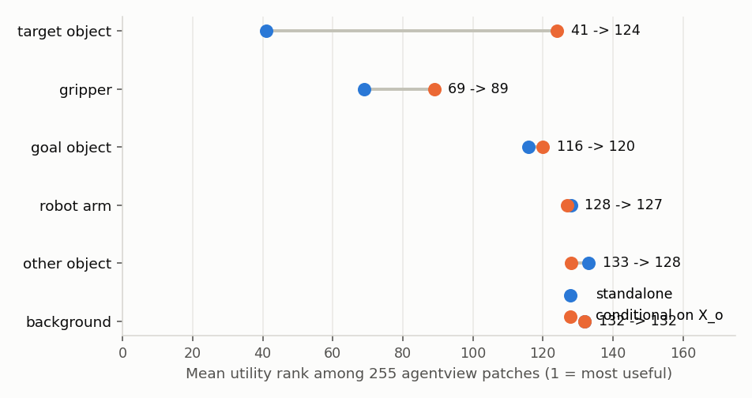

*Figure 3. Mean utility rank among the 255 other agentview patches, before and after conditioning on X_o.*

- **Pattern 1 (target patches matter alone): supported.** Target patches have the best standalone rank (41 of 255) and remove 16 % of the no-patch error on average.
- **Pattern 2 (gripper weak alone): not supported.** The best gripper patch is already strong by itself — median standalone rank 4 of 255 in the agentview (rank 9 of 511 over both views).
- **Pattern 3 (gripper becomes much more important after X_o): not supported.** The best gripper patch's median rank goes 4 → 5; it is in the conditional top 5 in 51 % of observations against 59 % standalone. Gripper patches *adjacent* to X_o show the most negative relative gain (−0.16 at distance 1, improving towards 0 by distance ≥ 6), i.e. they are partly redundant with it.
- **What actually changes is the target category:** once X_o is kept, the other target patches fall from rank 41 to 124 (redundancy term). The gripper wins the second slot because the alternatives collapse, not because its own utility rises. Raw G is negative for every category because MSE(none) ≈ 2.4 × MSE(X_o); ranks and relative gain are the fair comparison.

### 3.4 The best partner changes with the phase of the task

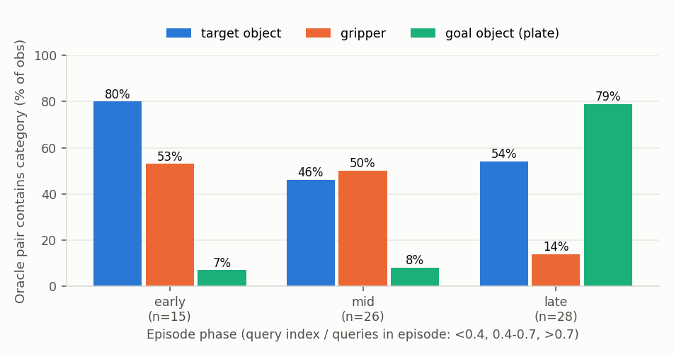

*Figure 4. Share of observations whose global oracle pair contains each category, by episode phase.*

| Phase | n | Oracle = target + gripper | Best conditional partner is gripper | … is the plate | Oracle MSE | VLA-Pruner MSE |
|---|---|---|---|---|---|---|
| Early (reach) | 15 | 40 % | 33 % | 13 % | 0.0187 | 0.0681 |
| Mid (grasp) | 26 | 23 % | 31 % | 12 % | 0.0109 | 0.0549 |
| Late (transport/place) | 28 | 7 % | 7 % | 68 % | 0.0119 | 0.0504 |

Over all observations the oracle pair contains a target patch in 57 %, a gripper patch in 36 % and a plate patch in 36 %; target + gripper is the single most common make-up (20 %), followed by plate + target (15 %). Late in the episode the plate replaces the gripper as the useful partner: the complement is whatever the *next* motion is relative to.

### 3.5 What VLA-Pruner keeps
- **Pattern 6 (VLA-Pruner keeps several target patches): not supported.** At 1 patch/view its most common pair is *other object + target* (19 of 69); target + target occurs 3 times. At 2 patches/view its wrist pair is gripper + target in 25 of 69.
- Its failure mode is **staleness, not target fixation**: the agentview pick is patch (r7, c10) in 16 observations across tasks and the same column c10 in 31; on average it produces only 2.05 distinct pairs across 3.45 analysed queries of an episode while the scene changes. At this budget the attention score behaves like a position prior.

### 3.6 Example frames

In the "retained patches" column of every frame figure, the violet dash-dot boxes drawn slightly larger than a patch mark the **oracle pair restricted to one patch per view**. This is the like-for-like reference for VLA-Pruner, whose released OFT code always keeps the same number of patches in each view. The title line of each figure gives its MSE as "oracle one/view". Where the unrestricted oracle pair already has one patch in each view (Figures 6 and 8), the two sets of boxes coincide.

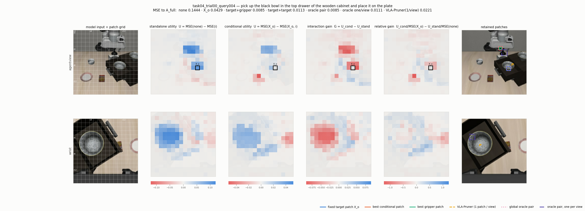

*Figure 5. Task 4, query 4 of 15 (early stage: the first analysed query, right after the three warm-up queries; the arm has just started reaching for the bowl in the cabinet drawer). With the agentview bowl patch X_o fixed, the best of all 511 partners is an agentview gripper patch (rank 4 standalone → 1 conditional), and target + gripper is exactly the global oracle pair, both patches in the agentview: 0.0085, against 0.0429 for X_o alone and 0.0113 for the best second target patch. The conditional map stays positive on the gripper and on the wrist-view bowl, while the agentview bowl patches next to X_o drop to about zero. VLA-Pruner keeps a bowl patch in each camera (0.0221), a reasonable pair but still 2.6× the oracle's error.*

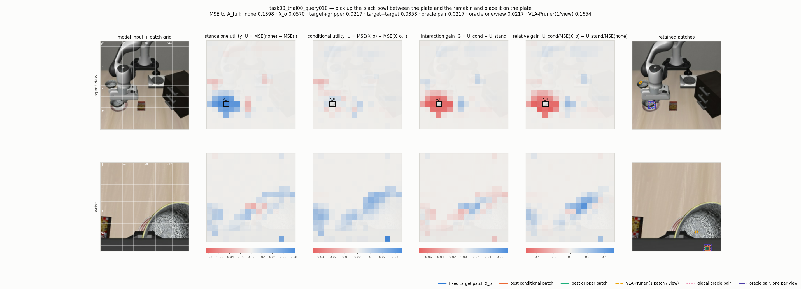

*Figure 6. Task 0, query 10 of 10 (late stage, bowl held next to the plate) — the clearest supportive case: with X_o fixed, the best of 511 partners is a wrist gripper patch (rank 11 → 1) and target + gripper is exactly the oracle pair (0.0217 vs 0.0358 for target + target). VLA-Pruner (0.1654) is worse than no patch (0.1398).*

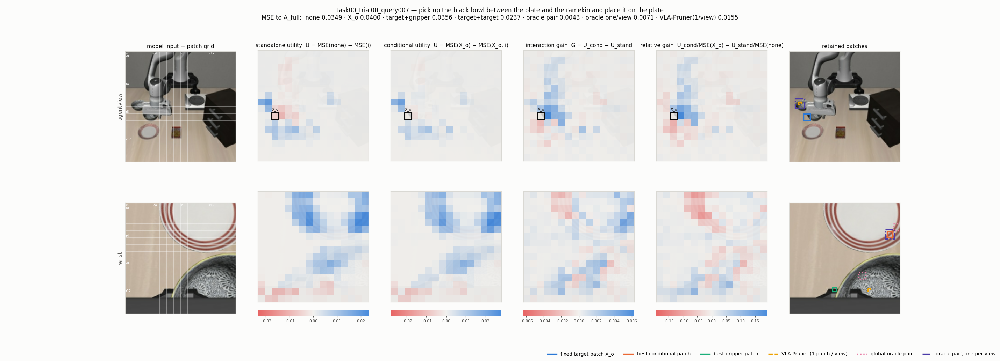

*Figure 7. Task 0, query 7 — positive gain on gripper/arm patches beside X_o and negative gain on neighbouring bowl patches, yet the oracle pair is a wrist bowl patch + plate rim (0.0043).*

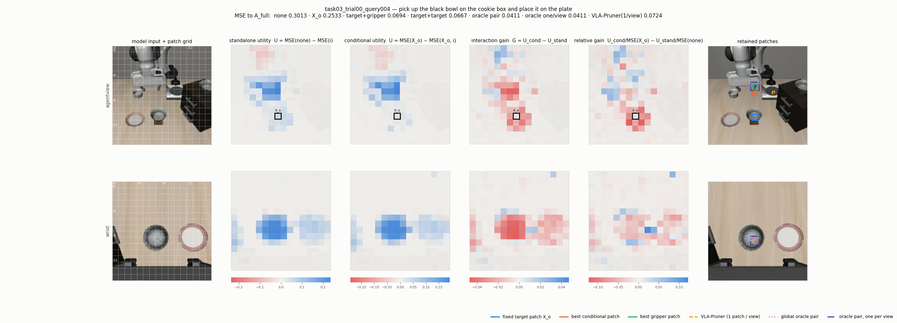

*Figure 8. Task 3, query 4 of 11 (early stage) — an agentview bowl patch alone barely helps (0.2533 vs 0.3013 none); nearly all useful partners are in the wrist view.*

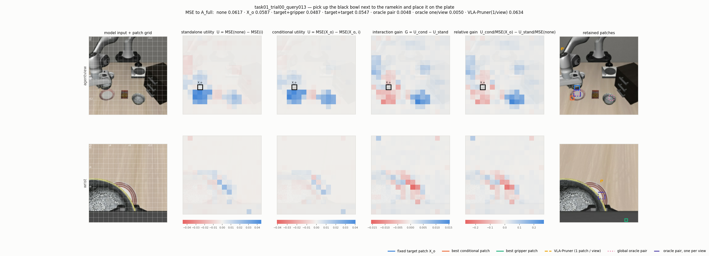

*Figure 9. Task 1, query 13 (late) — the oracle keeps plate + neighbouring object in the agentview; neither target nor gripper.*

### 3.7 One episode, every query

To see how the picture evolves inside one episode, task 4 ("pick up the black bowl in the top drawer of the wooden cabinet and place it on the plate", episode 1, 15 queries, success) was re-run with the brute-force analysis at **every** query after warm-up (queries 4–15, 12 observations, 2.6 h). The re-run reproduces the main run bit-for-bit at the four queries they share (identical A_full, max |ΔMSE| over all 130,816 pairs = 0). X_o is the best agentview target patch at each query.

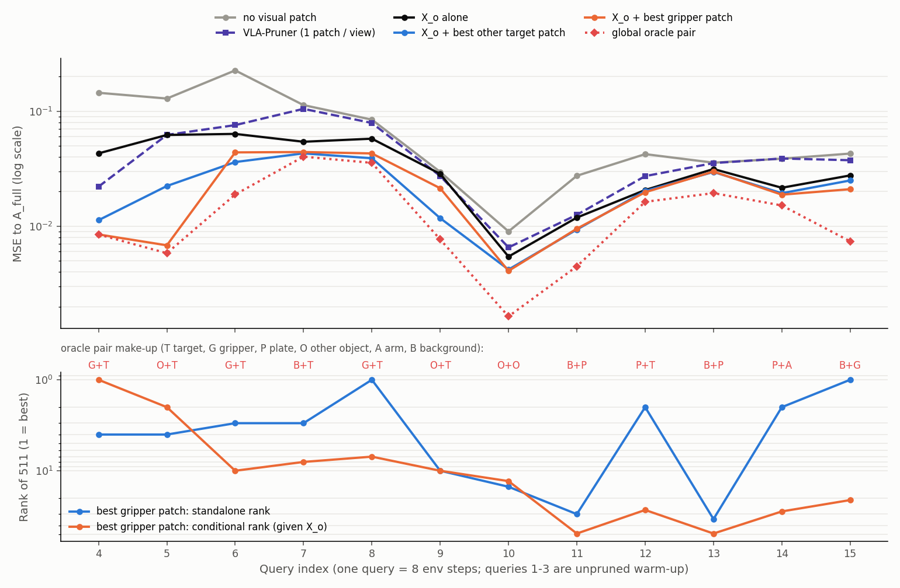

*Figure 10. Top: MSE to A_full at every query for six retained sets. Bottom: rank of the best gripper patch among 511 candidates, standalone and conditional on X_o; the red letters give the make-up of the global oracle pair at each query.*

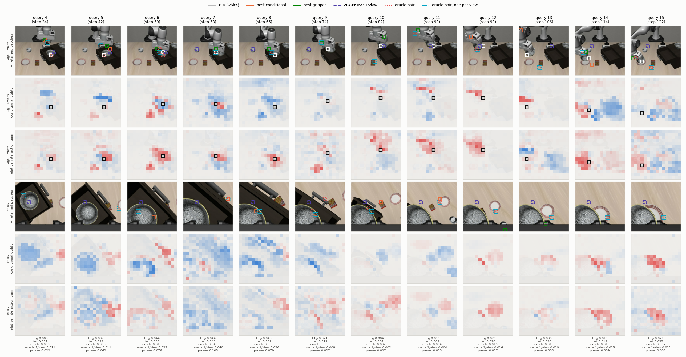

*Figure 11. Every analysed query of the episode. Rows, for each camera: the view with retained patches, the conditional utility given X_o, and the relative interaction gain U_cond/MSE(X_o) − U_stand/MSE(none) (blue = the patch matters more once X_o is kept, red = it is redundant with X_o; each map is scaled to its own maximum). X_o white, best conditional partner orange, best gripper patch green, VLA-Pruner (1 patch/view) dashed violet, global oracle pair dotted red, oracle pair restricted to one patch per view dash-dot cyan (drawn slightly larger than the patch). The text under each column gives the MSE of each set.*

| Query | Env step | Stage | No patch | X_o | X_o + target | X_o + gripper | Oracle pair | VLA-Pruner | Oracle pair make-up | Best gripper rank, standalone → conditional |
|---|---|---|---|---|---|---|---|---|---|---|
| 4 | 34 | reach | 0.1444 | 0.0429 | 0.0113 | **0.0085** | 0.0085 | 0.0221 | gripper + target | 4 → 1 |
| 5 | 42 | reach | 0.1287 | 0.0621 | 0.0223 | **0.0068** | 0.0058 | 0.0622 | other object + target | 4 → 2 |
| 6 | 50 | approach | 0.2262 | 0.0634 | **0.0361** | 0.0438 | 0.0188 | 0.0756 | gripper + target | 3 → 10 |
| 7 | 58 | grasp | 0.1129 | 0.0542 | **0.0429** | 0.0441 | 0.0402 | 0.1047 | background + target | 3 → 8 |
| 8 | 66 | grasp | 0.0844 | 0.0576 | **0.0389** | 0.0429 | 0.0355 | 0.0789 | gripper + target | 1 → 7 |
| 9 | 74 | lift | 0.0296 | 0.0285 | **0.0117** | 0.0214 | 0.0077 | 0.0273 | other object + target | 10 → 10 |
| 10 | 82 | lift | 0.0090 | 0.0054 | 0.0042 | **0.0041** | 0.0016 | 0.0065 | other object + other object | 15 → 13 |
| 11 | 90 | transport | 0.0274 | 0.0119 | **0.0093** | 0.0095 | 0.0045 | 0.0126 | background + plate | 30 → 49 |
| 12 | 98 | transport | 0.0423 | 0.0206 | 0.0202 | **0.0197** | 0.0163 | 0.0272 | plate + target | 2 → 27 |
| 13 | 106 | transport | 0.0357 | 0.0314 | **0.0296** | 0.0299 | 0.0194 | 0.0353 | background + plate | 34 → 49 |
| 14 | 114 | place | 0.0386 | 0.0216 | 0.0193 | **0.0188** | 0.0151 | 0.0388 | plate + robot arm | 2 → 28 |
| 15 | 122 | place | 0.0428 | 0.0276 | 0.0250 | **0.0210** | 0.0074 | 0.0374 | background + gripper | 1 → 21 |

Stage names are read off the frames in Figure 11. What the episode shows:

- **Reach (queries 4–5): the hypothesis in its purest form.** With the bowl patch kept, the gripper patch is the best or second-best of all 511 partners (rank 4 → 1 and 4 → 2) and target + gripper sits on the oracle (0.0085 = oracle; 0.0068 vs 0.0058). A second target patch is 1.3–3.3× worse.
- **Approach and grasp (6–9): the advantage disappears.** The gripper now overlaps the bowl in the image, its conditional rank drops (3 → 10, 1 → 7) although it is still the top *standalone* patch at query 8, and a second bowl patch from the wrist view is the better partner. The oracle still uses a gripper patch at queries 6 and 8, but paired with a different target patch than X_o.
- **Transport and place (10–15): everything is easy and the plate matters.** Absolute errors fall by an order of magnitude (A_full barely depends on vision while the arm carries the bowl), target + gripper and target + target become indistinguishable (differences ≤ 0.004), the oracle moves to plate/background patches, and the gripper patch — which now holds the bowl — is strong alone (rank 1–2 at queries 12, 14, 15) but largely redundant with X_o (rank 21–28 conditional).
- **Inside the agentview only**, target + gripper beats target + target at 9 of the 12 queries, by the largest margins during the reach (0.0085 vs 0.0204, 0.0068 vs 0.0565).
- **VLA-Pruner's wrist pick is the same grid cell (row 6, column 4) at all 12 queries** while the bowl moves across the wrist image; its agentview pick takes 5 positions. It is on the bowl only at queries 4–5. At 10 of the 12 queries (all except 4 and 9) its two patches are no better than the single patch X_o, and at queries 7, 8, 13 and 14 its error is within 8 % of the no-patch error.

### 3.8 Scorecard

| # | Predicted pattern | Verdict | Evidence |
|---|---|---|---|
| 1 | Target patches have high standalone importance | Supported | best standalone rank of all categories; 16 % of error removed per patch |
| 2 | Gripper patches have low/moderate standalone importance | Not supported | best gripper patch is median rank 4/255 alone |
| 3 | Gripper becomes much more important after X_o | Not supported | rank 4 → 5; adjacent gripper patches are partly redundant with X_o |
| 4 | Target + gripper < target + target in error | Supported within one image (85 %, 19/20 episodes); reversed when the second camera is available | §3.2 |
| 5 | Oracle frequently retains target + gripper | Partly | most common pair (20 %), mainly early/mid episode; plate takes over late |
| 6 | VLA-Pruner keeps multiple target patches | Not supported | it keeps stale, position-like picks; 4.3× oracle error |

### 3.9 Conclusion and implications for pruning
1. **Conditional selection matters, and the dominant term is redundancy.** After one target patch, other target patches lose almost all value (rank 41 → 124, +0.003 MSE improvement), while the oracle partner cuts the error by a further 2–3×. A selector that scores patches independently will stack redundant patches; one that discounts similarity to what is already kept would capture most of the gain.
2. **The useful complement is "the other thing the motion is relative to", not the gripper per se**: gripper during reach/grasp, plate during transport, and — most strongly — the *other camera's* view of the target. For a two-view model the first-order rule is one informative patch per view (one-per-view oracle 0.0140 vs unrestricted 0.0130).
3. **The interaction term is real but modest and local in time**: target + gripper is the exact global optimum in 20 % of observations, concentrated in the first 70 % of the episode.
4. **VLA-Pruner's extreme-budget failure is temporal staleness of its picks**, not the salience bias hypothesised. Its two patches are worse than none in 17 % of observations.

### 3.10 Caveats
- 69 observations from 20 episodes; tests are episode-clustered, but tasks share one scene family (LIBERO-Spatial).
- States come from the unpruned policy; this measures what a selector *should* keep on-trajectory, not closed-loop success.
- Labels use a 20 % coverage rule on 14-px patches; "other object" includes the fixed stove/cabinet.
- bf16 batch-shape noise in the evaluator is ~0.005 L1 (August); pair differences below that are not rankings.
- MSE differences are an empirical proxy, not estimates of the information-theoretic terms.

### 3.11 Where everything lives
- Raw tables (69 npz: full/none/single/pair actions and MSE/L1, labels, images, VLA-Pruner picks and scores): robot18 `outputs_HDD/conditional_patch_utility/main_2026-09-18/`, mirrored on robot4 `outputs_HDD4/conditional_patch_utility_main/data/`
- Single-episode dense run (task 4, all 12 post-warm-up queries): robot18 `outputs_HDD/conditional_patch_utility/episode_task04_all_queries/`, mirrored on robot4 `outputs_HDD4/conditional_patch_utility_episode/` (data, `episode_analysis.py`, figures, `episode_rows.json`)
- Analysis (per-frame CSV + top-10 tables, aggregates for three X_o variants, 20 frame figures): `outputs_HDD4/conditional_patch_utility_main/analysis/`; phase/locality/clustered tests: `.../extra/extra_stdout.txt`, script `.../extra_analysis.py`
- Code: `src/openvla-oft/experiments/robot/libero/{run,analyze}_conditional_patch_utility.py`, `_conditional_patch_utility_tables` in `prismatic/extern/hf/modeling_prismatic.py`
